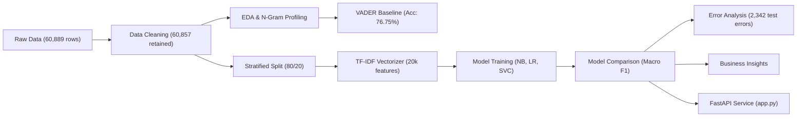

# Amazon Review Sentiment Analysis using NLP and Machine Learning

An end-to-end, portfolio-grade Natural Language Processing (NLP) and Machine Learning project analyzing over **60,000 Amazon customer reviews** across 5 product categories. This project benchmarks an unsupervised lexicon baseline (**VADER**) against multiple supervised machine learning models (**TF-IDF + Logistic Regression, Linear SVC, and Multinomial Naive Bayes**), conducts rigorous error analysis, extracts actionable business intelligence, and packages the best-performing model into a **FastAPI** inference backend.

---

## Table of Contents
1. [Project Overview](#1-project-overview)
2. [Problem Statement](#2-problem-statement)
3. [Objectives](#3-objectives)
4. [Dataset Description](#4-dataset-description)
5. [Technology Stack](#5-technology-stack)
6. [Project Workflow](#6-project-workflow)
7. [Exploratory Data Analysis](#7-exploratory-data-analysis)
8. [Text Preprocessing](#8-text-preprocessing)
9. [VADER Sentiment Analysis](#9-vader-sentiment-analysis)
10. [TF-IDF Feature Extraction](#10-tf-idf-feature-extraction)
11. [Machine Learning Models](#11-machine-learning-models)
12. [Model Evaluation and Comparison](#12-model-evaluation-and-comparison)
13. [Error Analysis](#13-error-analysis)
14. [Business Insights](#14-business-insights)
15. [FastAPI Backend](#15-fastapi-backend)
16. [Installation and Setup](#16-installation-and-setup)
17. [Running the Jupyter Notebook](#17-running-the-jupyter-notebook)
18. [Running the API](#18-running-the-api)
19. [API Endpoints and Example Requests](#19-api-endpoints-and-example-requests)
20. [Limitations](#20-limitations)
21. [Future Improvements](#21-future-improvements)

---

## 1. Project Overview
This project presents an empirical, portfolio-quality text analytics and sentiment classification pipeline built on Amazon product reviews. By systematically progressing from raw data ingestion and exploratory text profiling to heuristic baseline evaluation, supervised learning with class-balanced weighting, and microservice deployment, it demonstrates sound data science methodology without fabricating metrics or data sources.

---

## 2. Problem Statement
E-commerce marketplaces receive millions of customer reviews weekly across diverse categories. Manually reading and triaging feedback to detect defect surges, evaluate vendor reliability, or monitor customer sentiment is infeasible. Automated sentiment analysis systems are essential for early defect detection and proactive customer care, but real-world review text poses distinct challenges: severe positive class imbalance, mixed sentiment within single reviews, and contextual domain jargon.

---

## 3. Objectives
- Ingest and audit raw e-commerce customer reviews, ensuring strict data integrity.
- Profile text length, n-grams, and vocabulary distributions across product categories.
- Evaluate unsupervised rule-based sentiment scoring using NLTK's VADER as a zero-training benchmark.
- Train, evaluate, and compare supervised classification models (Multinomial Naive Bayes, Logistic Regression, Linear SVC) using TF-IDF n-gram vectors.
- Address severe class imbalance using balanced loss functions and prioritize **Macro F1** as the primary evaluation metric.
- Perform detailed qualitative and quantitative error analysis on misclassified reviews.
- Translate empirical findings into strategic business and catalog recommendations.
- Deploy the top-performing model as a high-performance, validated FastAPI REST service.

---

## 4. Dataset Description
The dataset contains **60,889 original records** stored in `data/raw/reviews.csv`:
- `Unique_ID`: Integer unique identifier for each review.
- `Category`: Product vertical (`mobile`, `mobile accessories`, `smartTv`, `refrigerator`, `books`).
- `Review_Header`: Summary title of the user review.
- `Review_text`: Full body text of the review.
- `Rating`: Numerical user rating (1 to 5 stars).
- `Own_Rating`: Dataset-provided label mapping directly to star rating:
  - 1–2 stars: **Negative** (9,087 reviews; 14.9%)
  - 3 stars: **Neutral** (4,366 reviews; 7.2%)
  - 4–5 stars: **Positive** (47,436 reviews; 77.9%)

> **Important Label Context:**
> Target labels (`rating_sentiment` / `Own_Rating`) are **mechanically mapped from numerical star ratings**, not independently verified human-annotated sentiment. All evaluations measure alignment with customer star-rating polarity.

*Data Cleaning*: Direct inspection identified 32 records where `Review_text` was missing or whitespace-only. These were removed, retaining **60,857 reviews** in `df_clean`. Missing `Review_Header` values (5 records) were imputed with empty strings to preserve valid review texts and ratings.

---

## 5. Technology Stack
- **Programming Language**: Python 3.14
- **Data Manipulation & Analysis**: Pandas 3.1.1, NumPy 2.5.4, SciPy 1.18.1
- **Natural Language Processing**: NLTK 3.10.4 (VADER lexicon, stopwords)
- **Machine Learning**: Scikit-Learn 1.9.1 (TF-IDF Vectorizer, LogisticRegression, LinearSVC, MultinomialNB)
- **Data Visualisation**: Matplotlib 3.11.2, Seaborn 0.13.2
- **Backend API & Validation**: FastAPI 0.162.0, Uvicorn 0.54.0, Pydantic 2.14.3
- **Serialization**: Joblib 1.6.0

---

## 6. Project Workflow


---

## 7. Exploratory Data Analysis
- **Rating Distribution**: Substantially left-skewed: 5-star ratings account for 56.59% (34,460), while ratings 4 and 5 together represent 77.90% of reviews. 2-star ratings are the least frequent (3.46%).
- **Category Volumes**: `mobile` represents 37.37% (22,742), `mobile accessories` 24.34% (14,810), `smartTv` 24.01% (14,613), `refrigerator` 7.86% (4,784), and `books` 6.42% (3,908).
- **Review Length Skew**: Right-skewed distribution. Median review length is 11 words (61 characters). Unusually short reviews (< 3 words) account for 20.83% (12,678 reviews), while long detailed reviews (> 150 words) make up 4.09% (2,492 reviews).

---

## 8. Text Preprocessing
Text normalization is applied to create `clean_text` while strictly preserving sentiment integrity:
1. Converted text to lowercase.
2. Stripped HTML tags (`<.*?>`).
3. Stripped web URLs (`https?://\S+|www\.\S+`).
4. Normalized whitespace while preserving punctuation, contractions, and negation tokens (`not`, `no`, `never`, `neither`, `nor`).
5. **No stopwords or lemmatization** were removed from the actual modeling column `clean_text` to preserve context.

---

## 9. VADER Sentiment Analysis
NLTK's Valence Aware Dictionary and sEntiment Reasoner (VADER) was implemented as an unsupervised, rule-based baseline:
- Standard compound thresholds applied: $\ge 0.05 \implies$ Positive, $\le -0.05 \implies$ Negative, otherwise Neutral.
- **Full Dataset Baseline Accuracy**: **76.75%** (Agreement with rating-derived labels).
- **VADER Distribution**: 73.71% Positive (44,860), 15.65% Negative (9,526), 10.63% Neutral (6,471).
- **Limitation**: While VADER captures general polarity terms (*good*, *worst*), it lacks e-commerce domain knowledge and classifies factual hardware complaints (*"battery drains in 2 hours"*, *"phone heats up"*) as Neutral.

---

## 10. TF-IDF Feature Extraction
- **Configuration**: Scikit-Learn `TfidfVectorizer(max_features=20000, ngram_range=(1, 2), min_df=2)`.
- **Leakage Prevention**: Fitted **strictly on the 80% training partition** (48,685 reviews) and transformed onto the 20% test partition (12,172 reviews).
- Resulting sparse feature matrix: `(48685, 20000)` train, `(12172, 20000)` test.

---

## 11. Machine Learning Models
Three distinct algorithms were evaluated:
1. **Multinomial Naive Bayes**: Probabilistic word frequency baseline.
2. **Logistic Regression (`class_weight='balanced'`)**: Linear probability model applying inverse frequency class penalties to counteract positive class dominance.
3. **Linear Support Vector Classifier (`class_weight='balanced'`)**: Maximum margin classifier optimized for high-dimensional sparse text vectors.

---

## 12. Model Evaluation and Comparison

All models and the VADER baseline were benchmarked on the identical **12,172 held-out test reviews**:

| Model | Accuracy | Macro Precision | Macro Recall | **Macro F1 (Primary)** | Weighted F1 |
| :--- | :--- | :--- | :--- | :--- | :--- |
| **Logistic Regression (Balanced)** | **80.76%** | **0.6194** | **0.6850** | **0.6392** | **0.8297** |
| **Linear SVC (Balanced)** | 84.51% | 0.6249 | 0.6340 | **0.6292** | 0.8449 |
| **Multinomial Naive Bayes** | 85.98% | 0.5533 | 0.5407 | **0.5433** | 0.8238 |
| **VADER Baseline (Lexicon)** | 76.38% | 0.5274 | 0.5411 | **0.5317** | 0.7797 |

### Selected Champion Model: Logistic Regression (Balanced)
- **Top Macro F1 (0.6392)**: Outperforms VADER (0.5317) by **+10.75 percentage points**.
- **Balanced Class Recall**: Achieves **76.00% recall on Negative reviews** and **48.22% recall on Neutral reviews**, preventing minority class neglect.
- In contrast, unweighted Multinomial Naive Bayes exhibits a deceptive 85.98% accuracy by predicting Positive for nearly all samples while achieving only **1.26% recall on Neutral reviews**.

---

## 13. Error Analysis
Analysis of all **2,342 incorrect test predictions** from balanced Logistic Regression:
- **Negative Error Rate**: 21.52% (391 / 1,817 reviews)
- **Neutral Error Rate**: **57.73%** (504 / 873 reviews) — Neutral reviews represent mixed trade-offs (*"display is good but battery is poor"*), creating conflicting n-gram signals.
- **Positive Error Rate**: 15.26% (1,447 / 9,482 reviews)
- **Length Disparity**: Misclassified reviews are **50% longer** on average (mean **35.1 words** vs. **23.4 words** for correct predictions), showing that multi-clause sentences challenge linear bag-of-words models.

---

## 14. Business Insights
1. **Electronics Drive Over 91% of Catalog Dissatisfaction**:
   - `mobile accessories` has the lowest average rating (**3.98 / 5.00**) and highest negative review proportion (**16.45%**), followed by `smartTv` (**16.17%** negative) and `mobile` (**15.36%** negative).
   - In contrast, `books` achieved a **4.54** average rating and only **5.30%** negative reviews.
2. **Specific Hardware Defect Clusters**:
   - `mobile`: Complaints focus on *not working* (367), *camera quality* (189), and *battery life* (153).
   - `smartTv`: Complaints cluster around *not working* (243) and *sound quality* (98).
   - `mobile accessories`: High incidence of immediate component failure (*not working*, *stopped charging*).
3. **Strategic Recommendations**:
   - **Accessory Merchant Audits**: Enforce onboarding benchmarks and return audits for accessory suppliers exceeding a 10% return rate.
   - **Component Disclosures**: Require verified battery and audio specifications on low-scoring TV and mobile listings.
   - **Decouple Logistics from Product Ratings**: Provide separate review prompts for *Product Performance* vs. *Fulfillment Experience* so shipping delays do not depress manufacturer product ratings.
   - **Automated Support Triaging**: Deploy the balanced Logistic Regression model to route reviews predicted as Negative with confidence $>80\%$ into high-priority customer care queues.

---

## 15. FastAPI Backend
The production inference microservice is implemented in [`app.py`](app.py) using the Step 7 exported artifacts:
- [`artifacts/tfidf_vectorizer.joblib`](artifacts/tfidf_vectorizer.joblib)
- [`artifacts/logistic_regression_model.joblib`](artifacts/logistic_regression_model.joblib)

### Key Features
- Lifespan model loading on application startup.
- Input validation rejecting empty or whitespace-only inputs with HTTP 422.
- Preprocessing identical to the notebook pipeline.
- Returns predicted sentiment, confidence score, and full class probability distribution.

---

## 16. Installation and Setup

### Prerequisites
- Python 3.10+ (tested on Python 3.14 on Windows)
- Git

### Windows PowerShell Setup
```powershell
# 1. Clone repository
git clone https://github.com/PVSSP656/sentiment-analysis.git
cd sentiment-analysis

# 2. Create virtual environment
python -m venv .venv
.venv\Scripts\Activate.ps1

# 3. Install pinned dependencies
pip install -r requirements.txt
```

### Dataset Note
> The raw dataset (`data/raw/reviews.csv`) is excluded from Git to comply with repository hygiene and size best practices. To run the full notebook training workflow locally, place your local `reviews.csv` inside `data/raw/reviews.csv`. The exported model artifacts in `artifacts/` are tracked, so the FastAPI service runs immediately without needing the raw dataset.

---

## 17. Running the Jupyter Notebook
```powershell
jupyter notebook notebooks/sentiment_analysis_clean.ipynb
```
The notebook executes end-to-end, reproducing all analytical sections, EDA plots, baseline comparisons, and model evaluations.

---

## 18. Running the API
Start the local Uvicorn server:
```powershell
uvicorn app:app --reload --port 8000
```
- API Base URL: `http://127.0.0.1:8000`
- Interactive Swagger UI: `http://127.0.0.1:8000/docs`

---

## 19. API Endpoints and Example Requests

### 1. `GET /` — API Status
```bash
curl http://127.0.0.1:8000/
```
```json
{
  "status": "online",
  "service": "Amazon Review Sentiment Analysis API",
  "docs_url": "/docs",
  "description": "POST a review to /predict for sentiment classification."
}
```

### 2. `GET /health` — Health Check
```bash
curl http://127.0.0.1:8000/health
```
```json
{
  "status": "healthy",
  "artifacts_loaded": true,
  "model_type": "Logistic Regression (Balanced)",
  "vectorizer": "TF-IDF (20,000 max features, n-gram 1-2)"
}
```

### 3. `POST /predict` — Sentiment Prediction
```bash
curl -X POST "http://127.0.0.1:8000/predict" \
     -H "Content-Type: application/json" \
     -d "{\"review\": \"The display is crisp and vivid, and the camera quality is outstanding!\"}"
```
```json
{
  "review": "The display is crisp and vivid, and the camera quality is outstanding!",
  "predicted_sentiment": "Positive",
  "confidence": 0.8397,
  "class_probabilities": {
    "Negative": 0.0274,
    "Neutral": 0.1329,
    "Positive": 0.8397
  },
  "note": "Confidence is the model's estimated class probability from logistic regression, not a guarantee of human-verified truth."
}
```

---

## 20. Limitations
- **Rating-Derived Proxy Labels**: Target labels are partitioned from star ratings, not independently verified by human linguists.
- **Bag-of-Words Context Boundaries**: TF-IDF ignores syntactic clause structure and contrastive conjunctions (*"however"*, *"although"*), which accounts for errors in longer, mixed reviews.
- **Category Skew**: The dataset is concentrated across 5 product verticals with unequal volume (`mobile` accounts for 37.4% while `books` is 6.4%).
- **Observational Findings**: N-gram complaint correlations describe observational associations, not causal hardware defect proof.

---

## 21. Future Improvements
- **Transformer Fine-Tuning**: Fine-tune domain-specific transformer models (e.g. RoBERTa or DeBERTa) to capture long-range contextual dependencies and contrastive clauses.
- **Aspect-Based Sentiment Analysis (ABSA)**: Deconstruct reviews into aspect-level sentiments (e.g., *Battery: Negative*, *Screen: Positive*) rather than a single document-level classification.
- **Automated Explainability**: Integrate SHAP (SHapley Additive exPlanations) or LIME to provide token-level attribution in the API response.
- **Containerization & CI/CD**: Package the FastAPI microservice into a multi-stage Docker container with GitHub Actions automated test suites.
